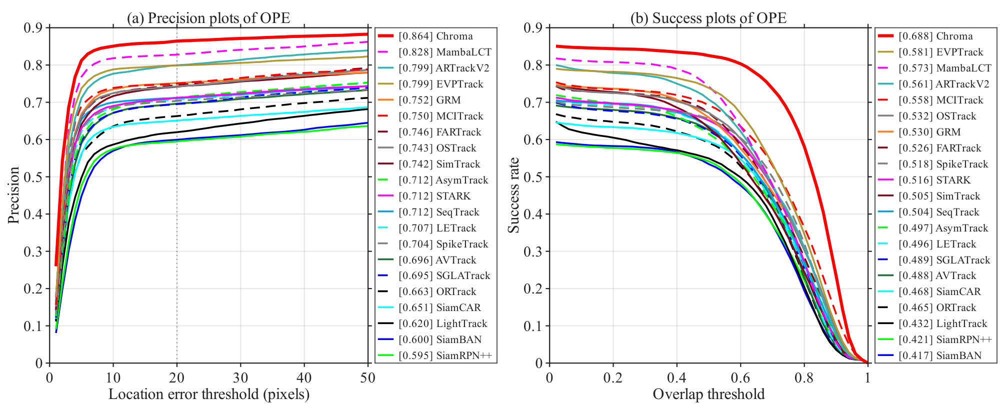
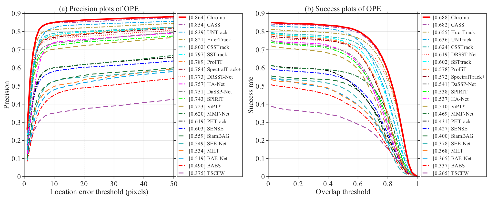
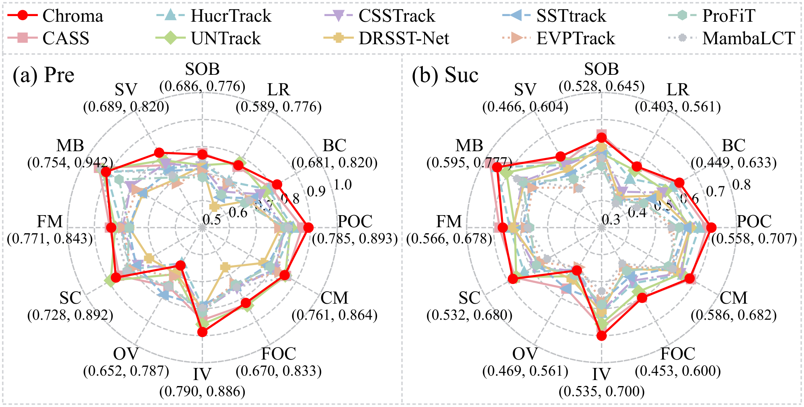
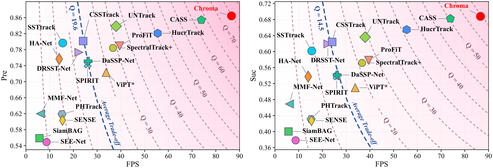
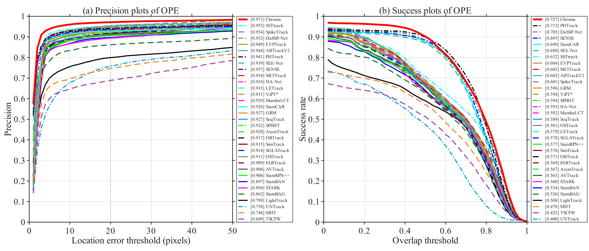
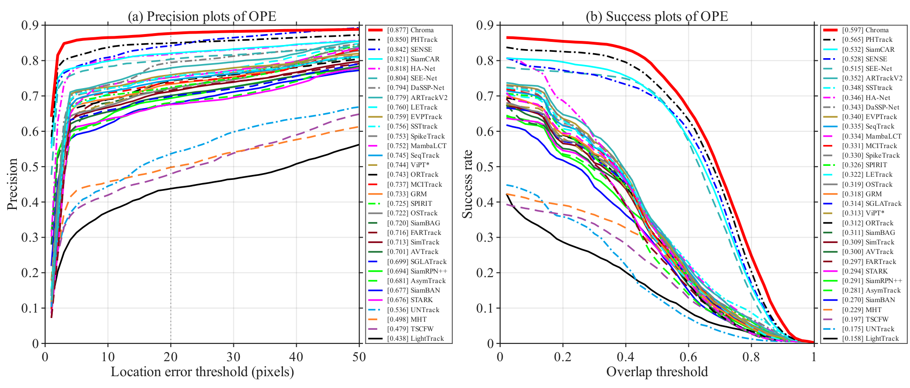
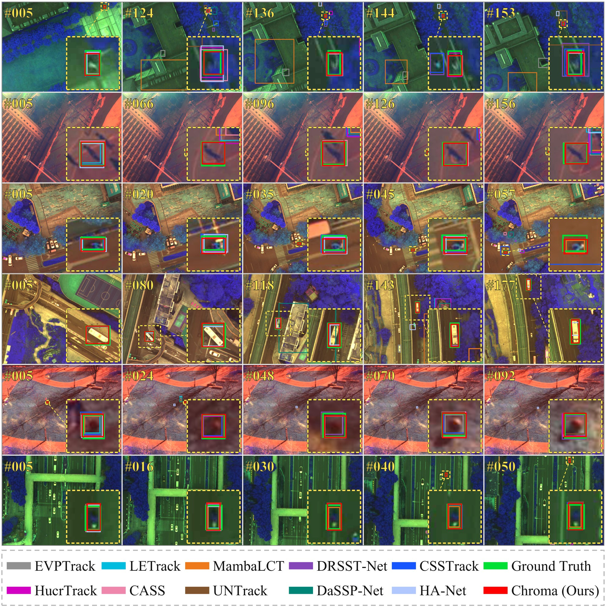
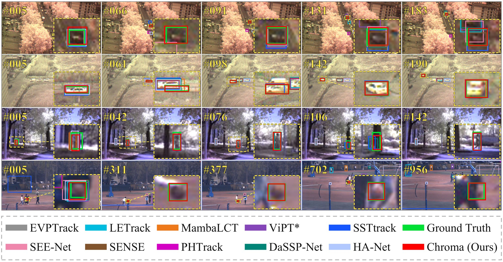
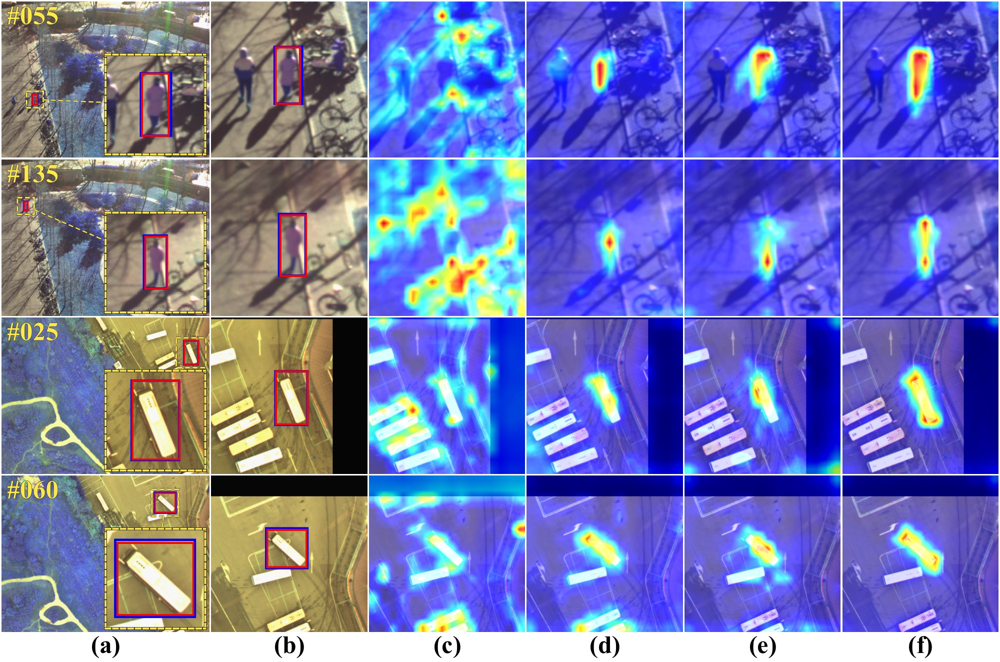

# Chroma

**Chroma** is a tracker for UAV multispectral video object tracking.

## Benchmarks and Metrics

Chroma is evaluated on the UAV multispectral benchmark **MUST** and four ground-based benchmarks, **IMEC25**, **MSSOT**, **HOTC23**, and **HOTC24** ([hsitracking.com](https://www.hsitracking.com/)). All trackers follow the one-pass evaluation (OPE) protocol. **Pre** is the precision at a 20-pixel center-error threshold, and **Suc** is the area under the success plot.

## Results on MUST

<em>Precision and success plots of RGB trackers on MUST. RGB trackers take false-color input.</em>

<em>Precision and success plots of hyperspectral and multispectral trackers on MUST. ViPT* denotes ViPT with multispectral input.</em>

<em>Attribute-wise (a) Pre and (b) Suc on MUST.</em>

<em>Accuracy and speed of hyperspectral and multispectral trackers on MUST, with Pre on the left and Suc on the right. Baseline FPS values follow published reports.</em>

## Results on Ground-Based Benchmarks

<em>Precision and success plots on IMEC25.</em>

<em>Precision and success plots on MSSOT.</em>

## Visualization

<em>Tracking examples on six MUST sequences. Yellow dashed boxes enlarge the target regions.</em>

<em>Tracking examples on IMEC25, MSSOT, HOTC23, and HOTC24, from top to bottom.</em>

<em>Attention evolution on two MUST sequences. (a) Full frames with enlarged insets. (b) Search regions. (c)–(f) Template-to-search attention at Transformer depths 1, 10, 15, and 20, from shallow to deep.</em>

